  

> Site vitrine de TrackShip.

  

**Statut** — 🔴 Conteneur arrêté — le domaine répond encore mais l'application ne tourne plus

---

# TrackShip — site

## Le problème

Le projet avait besoin d'une page publique pour être montré et testé, séparée du code de l'application.

## Ce que fait le projet

- Une page de présentation
- Une page de test des jetons (`token.html`)
- Un compteur d'appels et le proxy EuRIS, côté serveur
- Un script d'initialisation de la base

## Structure

`index.html` · `token.html` · `api/compteur.php`, `api/euris-proxy.php`, `api/init.php` · `api/init-database.sql` · `Dockerfile`

## Lancer le projet

`docker build -t trackship-site . && docker run -p 8080:80 trackship-site`.

---

Développé par **Bakari Abidina** · [bakabi.fr](https://bakabi.fr)
